<p align="center">
  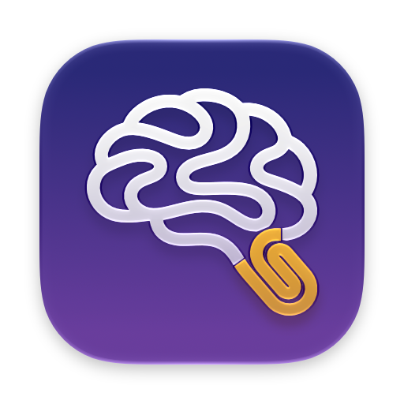
</p>

<h1 align="center">Cortex</h1>

<p align="center">
  Clipboard history, snippets, notes, to-dos and quick actions for macOS,<br>
  in one palette that opens with <kbd>⇧</kbd> <kbd>⌘</kbd> <kbd>V</kbd>.
</p>

<p align="center">
  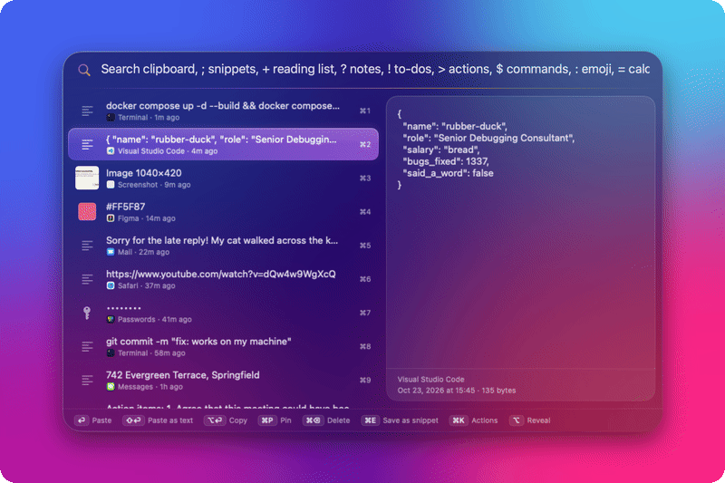
</p>

Cortex lives in the menu bar. Type to search what you copied, or start with a character to switch to another module:

| Type | For |
| --- | --- |
| *anything* | [Clipboard history](#clipboard-history) |
| `;` | [Snippets](#snippets) |
| `>` | [Quick actions](#quick-actions) |
| `$` | [Commands](#-commands) |
| `+` | [Reading list](#reading-list) |
| `?` and `!` | [Notes](#knowledge-base) and [to-dos](#to-dos) |
| `:` and `::` | [Emoji](#emoji) and [SF Symbols](#sf-symbols) |
| `=` | [Calculator](#calculator) |

Each module can be switched off in Settings, and one that is off does nothing at all. Your data stays on your Mac unless you switch on [Sync](#sync) (end-to-end encrypted, to a server of your own) or [AI](#ai-actions) (with your own OpenAI key). There is no download: you [build it from source](#installation).

## Clipboard history

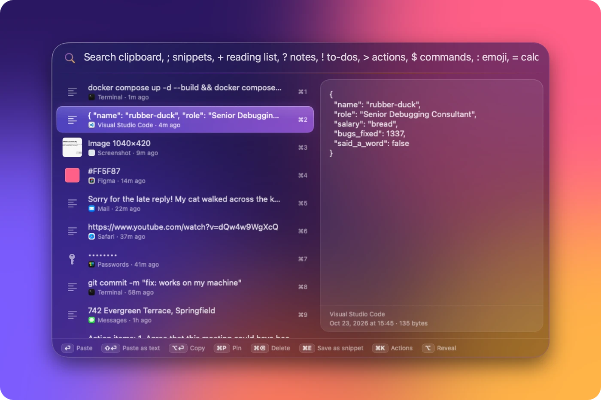

Everything you copy, searchable: text, rich text, images, files and colours, with the app it came from. ⏎ pastes into the app you were in, ⇧⏎ pastes plain text, ⌥⏎ only copies. ⌘P pins a clip, ⌘K runs a quick action on it. Passwords and copies from password managers are masked until you hold ⌥.

[More about the clipboard history →](docs/modules/CLIPBOARD.md)

## Snippets

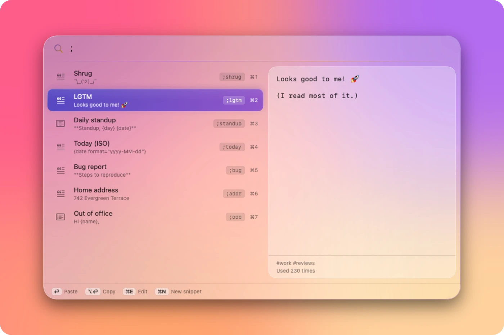

Texts you paste often, with placeholders: the date, the clipboard, the cursor position, or a value Cortex asks for before pasting. Pick one after `;`, or type its keyword in any app (keyword expansion, off by default). Raycast snippets import as they are.

[More about snippets →](docs/modules/SNIPPETS.md)

## Quick actions

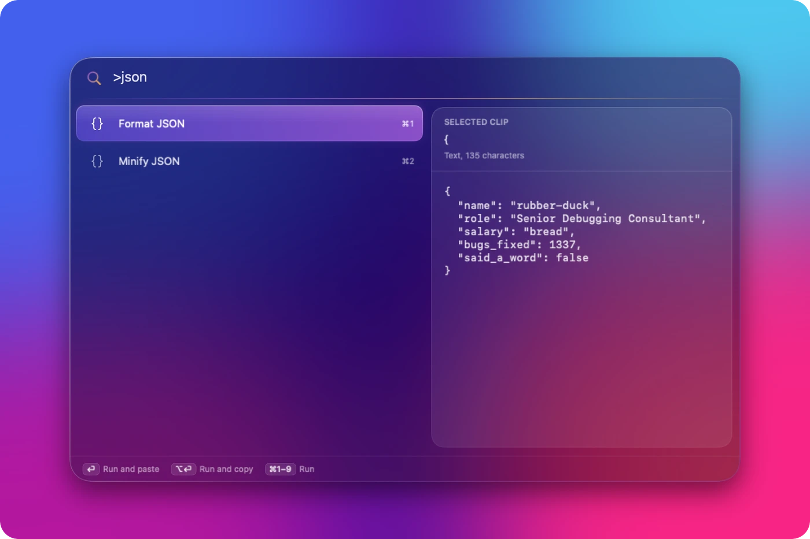

`>` turns the clipboard, a clip, the text selected in any app (⌃⌥⌘S) or the files selected in Finder (⌃⌥⌘A) into something else: formatted JSON, Base64, another case, a QR code, a smaller video. ⏎ pastes the result. Your own actions are a few lines of TOML that run a shell command or open a URL. The same actions are in Shortcuts and in Finder's Services menu.

[More about quick actions →](docs/modules/ACTIONS.md)

## `$` commands

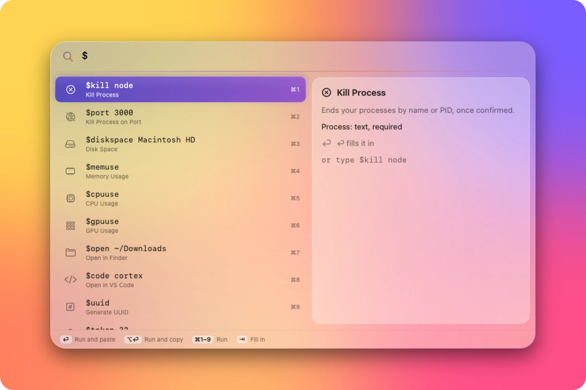

Commands that run on what you type: `$port 3000` shows what listens on a port and kills it, `$kill node`, `$disk`, `$mem` and `$cpu` (also over SSH), `$code cortex` opens a project in VS Code, `$term cortex` a terminal window in it, `$clip` saves a few seconds of a YouTube video that `$sound airhorn` plays, `$uuid`, `$token 32`. ⇥ opens a form with suggestions from your clipboard. Your own commands are TOML files too: `$gh apple/swift`, `$deploy`.

[More about commands →](docs/modules/COMMANDS.md)

## AI actions

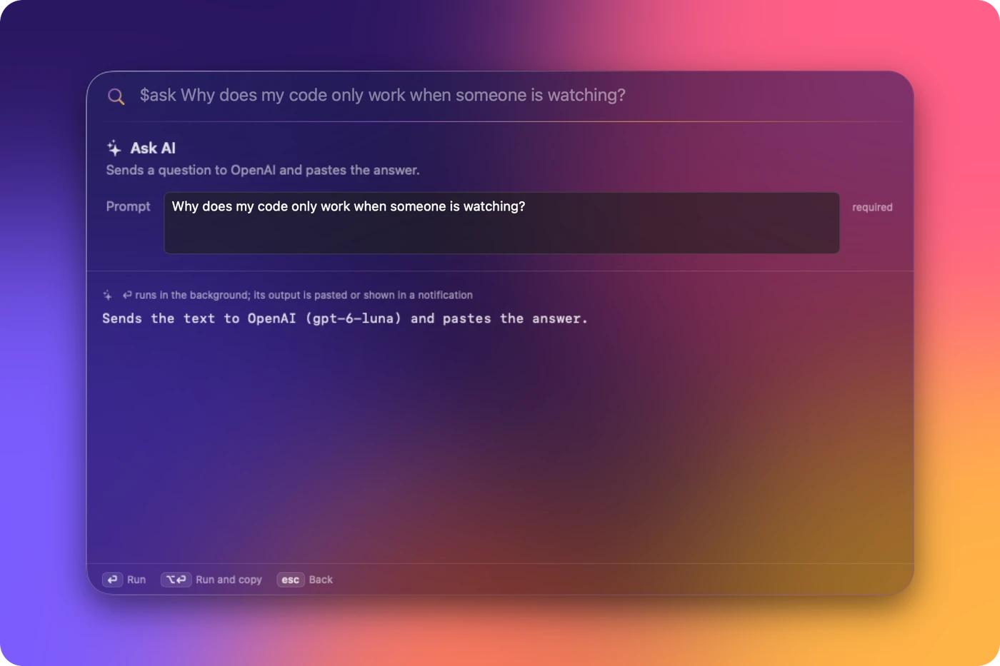

Off by default. With your OpenAI API key, Proofread and Summarize join the quick actions, `$ask` answers a question and `$img` draws a picture. Nothing is sent before ⏎, and sensitive clips never are. Settings shows the tokens used and an estimate of what they cost.

[More about AI actions →](docs/modules/AI.md)

## Reading list

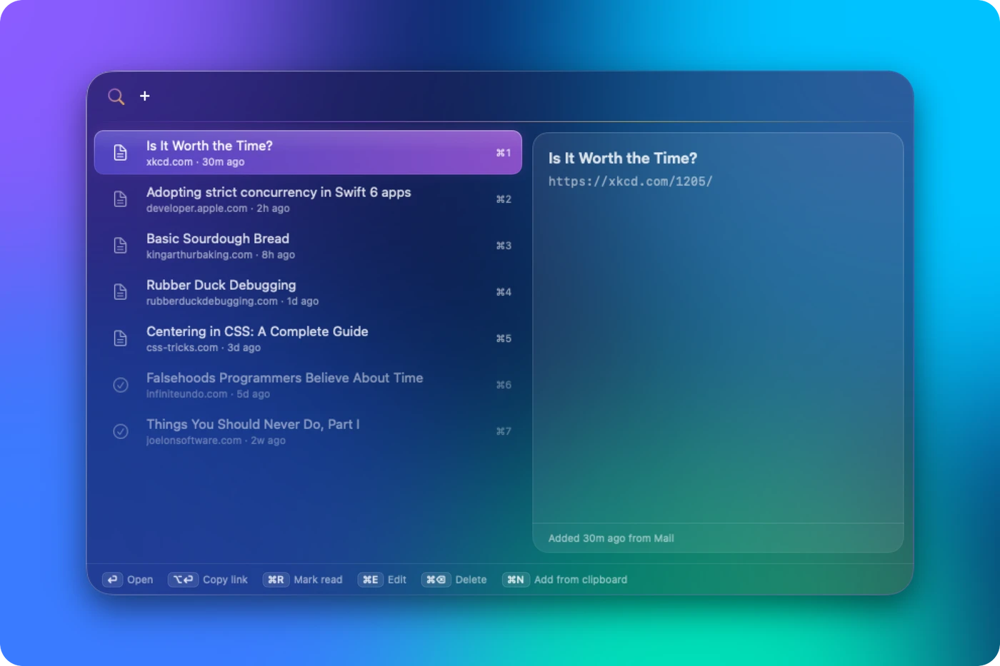

`+` keeps links to read later. Paste a link, or press ⌘N to add the one on the clipboard; ⏎ opens it and marks it read. Tracking parameters are removed, and Cortex never loads the pages.

[More about the reading list →](docs/modules/READING_LIST.md)

## Knowledge base

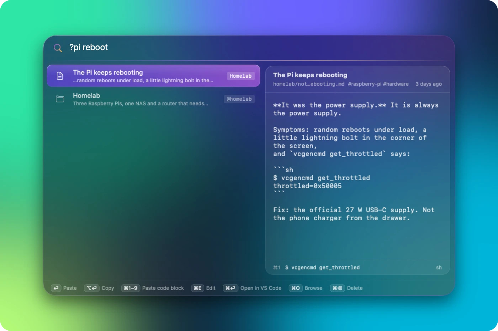

Notes, skills and to-dos as plain Markdown files in `~/.config/cortex/knowledge/`, one folder per project, so any editor, script or agent can use them, and git and Time Machine back them up. `?` searches all of it; when nothing matches, ⏎ saves what you typed as a note. ⌘1–9 paste a note's code blocks. Outline and Trello exports can be imported.

For agents, `cortex-mcp` (inside the app) gives Claude Code, Cursor and other MCP clients tools to search, read and write your notes and to write your own `$` commands and quick actions, and your skills can show up in Claude Code as its own. With AI on, `$note`, `$todo` and `$tidy` file things into the right project for you.

### To-dos

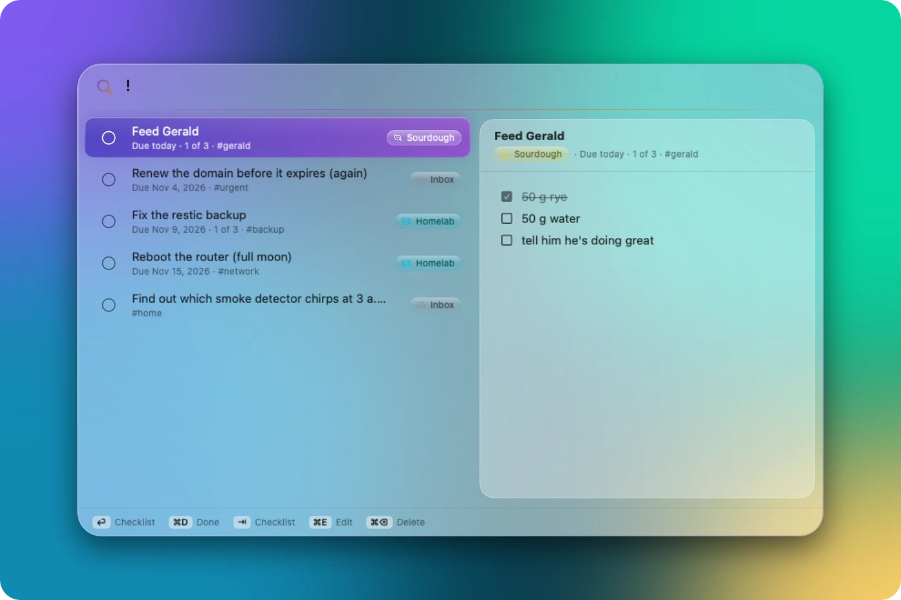

`!` lists the open to-dos, due ones first. Type to add one (`!fix the backup @homelab #urgent`), ⌘D to tick it off, ⇥ to work through its checklist.

[More about the knowledge base →](docs/modules/KNOWLEDGE.md)

## Emoji

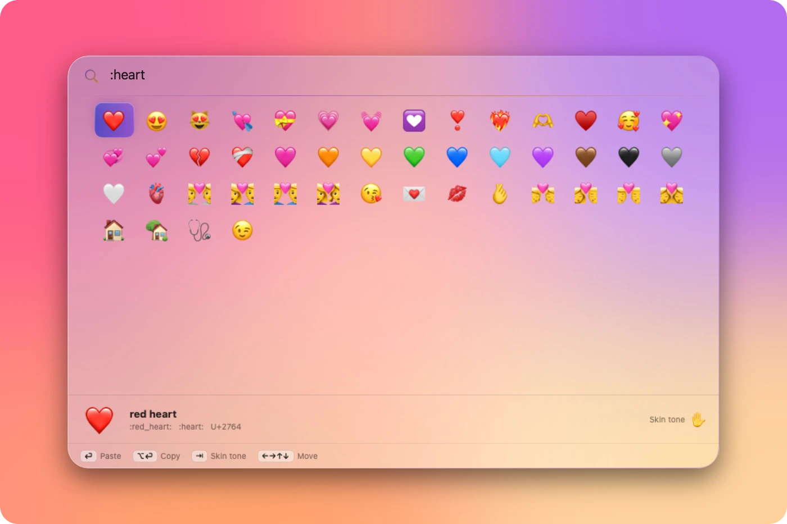

`:` searches emoji by name, keyword or shortcode, in English and your system languages. ⇥ picks the skin tone, and the ones you use most come first.

[More about emoji →](docs/modules/EMOJI.md)

## SF Symbols

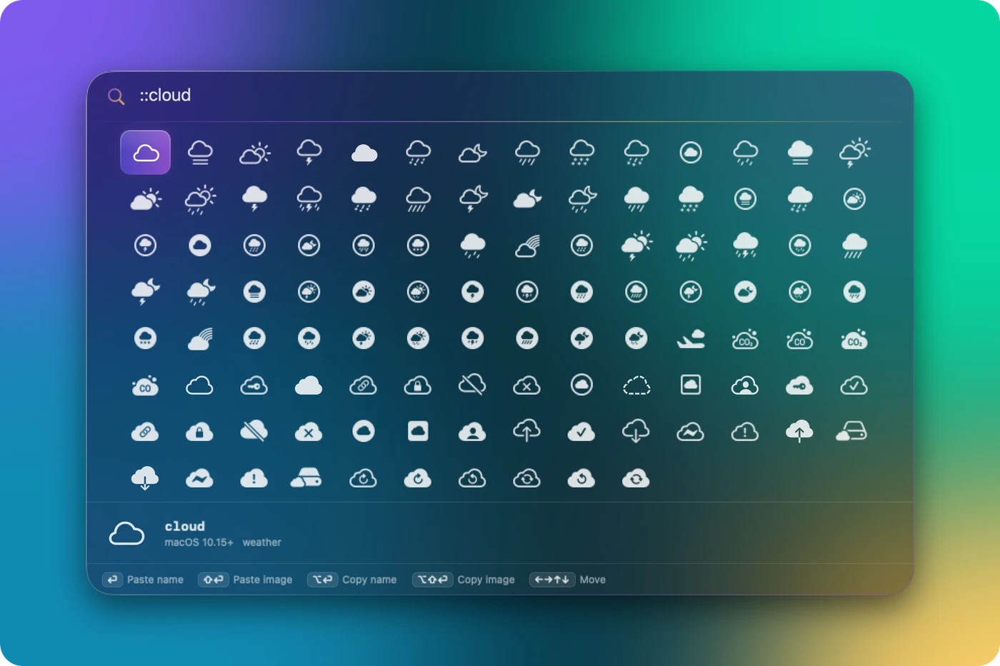

`::` searches the SF Symbols on your Mac. ⏎ pastes the symbol's name for Xcode, ⇧⏎ a picture of it for Keynote, Figma or Slack.

[More about SF Symbols →](docs/modules/SYMBOLS.md)

## Calculator

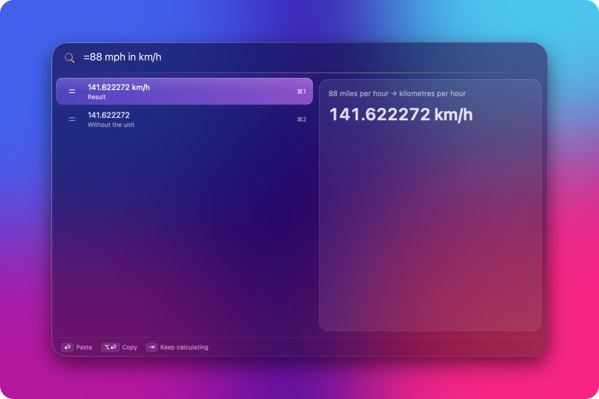

`=` calculates as you type: `=1920/1080`, `=sqrt(2) * pi`, `=15% * 80`. It converts units too: `=100 km/h in mph`, `=20 °C to F`, `=1 GiB to MB`. ⏎ pastes the result.

[More about the calculator →](docs/modules/CALCULATOR.md)

## Colour picker

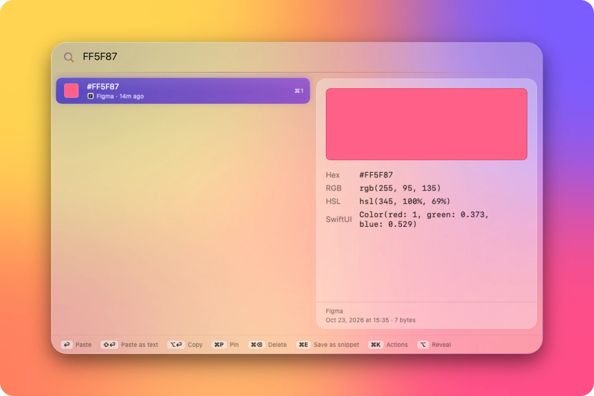

⌃⌥⌘C or `$color` shows the eyedropper and copies the colour you click as hex, CSS `rgb()` or `hsl()`, or SwiftUI. Colours in your history, picked or copied from a stylesheet, show as swatches with every format.

[More about the colour picker →](docs/modules/COLOR_PICKER.md)

## Text recognition

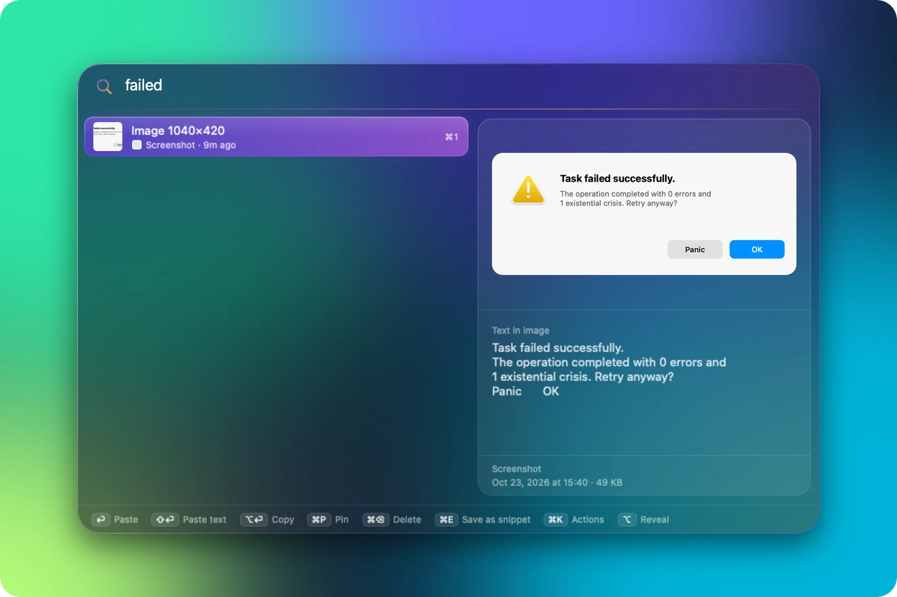

Screenshots in your history are found by the text in them, read on your Mac by Apple's Vision framework. With text recognition on, ⌃⌥⌘T copies the text in any region of the screen, and tables paste into Numbers cell by cell.

[More about text recognition →](docs/modules/TEXT_RECOGNITION.md)

## Sync

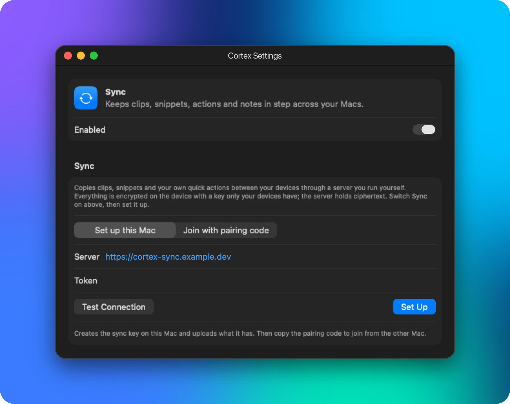

Off by default. Keeps clips, snippets, the reading list, notes and your quick actions in step between two Macs, through a small server you run yourself ([`sync-server/`](sync-server/README.md)). Everything is encrypted before it leaves the Mac, with a key only your Macs have, and nothing waits for the server.

[More about sync →](docs/modules/SYNC.md)

## Scrolling

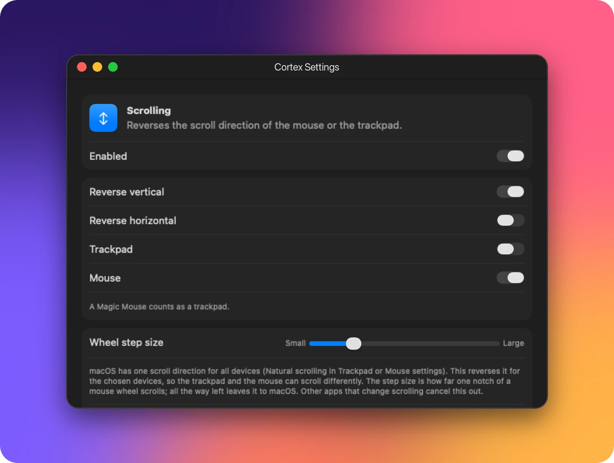

Off by default. Natural scrolling on the trackpad and the classic direction on the mouse, as Scroll Reverser does, per device and axis.

[More about scrolling →](docs/modules/SCROLLING.md)

## Installation

You need macOS 26, Xcode 27, [XcodeGen](https://github.com/yonaskolb/XcodeGen) (`brew install xcodegen`) and an Apple Development certificate, which keeps the Accessibility permission across updates.

**Do I need a paid Apple Developer Program membership?**

- **The Mac app: no, a free Apple ID should do.** Sign in to Xcode with it (Settings → Accounts) and Xcode creates an Apple Development certificate for your Personal Team. The Mac app uses no capability that needs a paid membership. It is not on the App Store, and you build it yourself, so notarization is not involved. This is untested with a free account, since the app is developed with a paid one; please open an issue if it fails for you.
- **The iPhone app: yes.** It shares its data with the share sheet extension and the widgets through an App Group, and the App Group needs a paid membership. Without one, build the Mac app only. Sync between two Macs does not need the iPhone app.
- With a free account, Apple limits App IDs (10 per week), devices (3) and apps per device (3), and its provisioning profiles expire after 7 days ([Apple's comparison](https://developer.apple.com/support/compare-memberships/)).

Details: [docs/INSTALL.md](docs/INSTALL.md#apple-developer-account).

```bash
git clone https://github.com/jonaszell97/Cortex.git
cd Cortex
make bootstrap
```

Fill in `DEVELOPMENT_TEAM` and `BUNDLE_ID_PREFIX` in `Config/Local.xcconfig`, then build and install into `/Applications`:

```bash
make install
```

Cortex appears in the menu bar, and ⇧⌘V opens the palette. Switch Cortex on in System Settings → Privacy & Security → Accessibility when it asks, so it can paste. To update, `git pull` and `make install` again.

Permissions, signing over SSH, uninstalling and where Cortex keeps your data: [docs/INSTALL.md](docs/INSTALL.md).

## Development

`make test` runs the core tests, `make test-app` the app's, and `make screenshots` redraws the pictures in this README. The rest is in [docs/DEVELOPMENT.md](docs/DEVELOPMENT.md), the design in [docs/ARCHITECTURE.md](docs/ARCHITECTURE.md), and every doc is listed in [docs/README.md](docs/README.md).

## License

[MIT](LICENSE)
